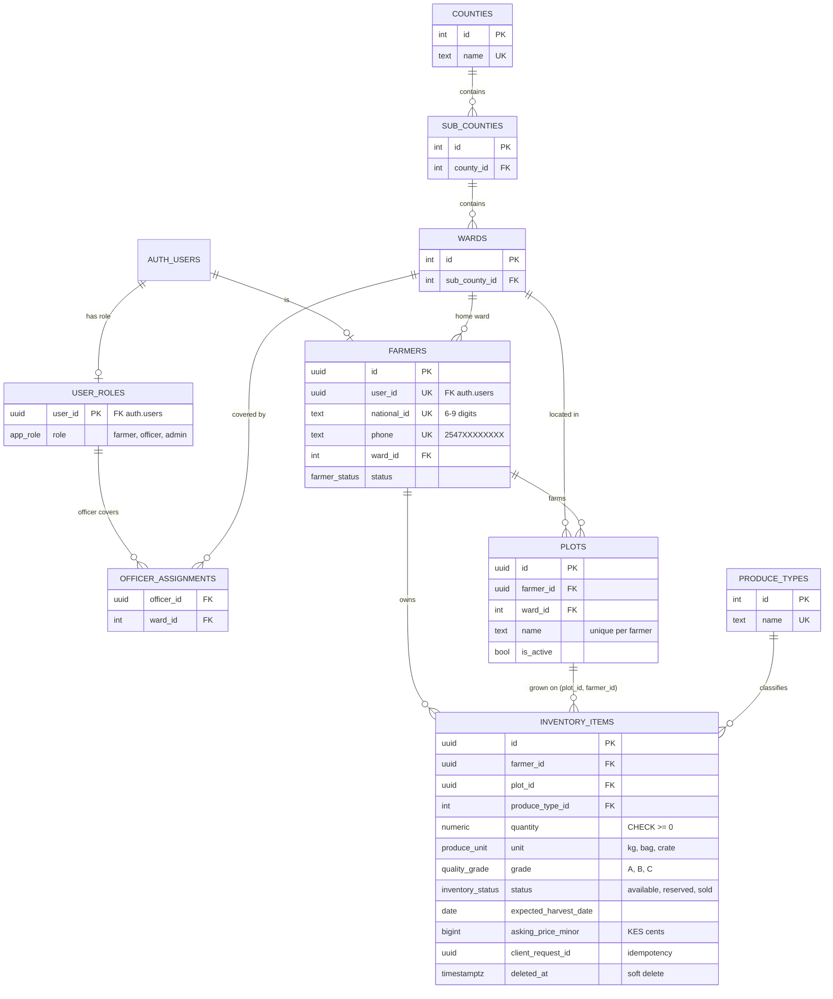

# Farmer Cooperative: Registration and Produce Inventory

A farmer registers once, then records the produce they have ready to sell. Officers see farmers and stock in their assigned wards (read-only). Admins manage everything.

| Part | Folder | Stack |
| --- | --- | --- |
| A. Data model | [`db/`](db) | PostgreSQL / Supabase: 5 re-runnable migrations, seed, RLS tests |
| B. Backend | [`api/`](api) | FastAPI, own JWT verification, 63 + 11 tests |
| C. Mobile app | [`app/`](app) | React Native (Expo, TypeScript), 34 tests |

More detail (API table, RLS table, indexes, tests): [`docs/ARCHITECTURE.md`](docs/ARCHITECTURE.md)

## Quick start

**1. Database.** Create an empty Supabase project. In the SQL Editor run `db/migrations/0001` to `0005` in order, then `db/seed.sql`. All files are safe to re-run.

**2. API** (Python 3.11+)
```bash
cd api
cp .env.example .env        # fill in Supabase values, see comments inside
python -m venv .venv && source .venv/bin/activate     # Windows: .venv\Scripts\Activate.ps1
pip install -r requirements-dev.txt
python -m pytest            # 63 passed, 11 skipped (no Supabase needed)
uvicorn app.main:create_app --factory --reload        # docs at http://localhost:8000/docs
```

**3. App** (Node 20+)
```bash
cd app
cp .env.example .env        # EXPO_PUBLIC_API_URL: Android emulator http://10.0.2.2:8000, browser/iOS simulator http://localhost:8000
npm install
npm test                    # 34 tests
npx expo start              # a = Android, i = iOS, w = browser
```
For the browser build also set `CORS_ORIGINS=http://localhost:8081` in `api/.env` and restart the API.

**Test logins** (from `seed.sql`, password `Passw0rd!2026`): `wanjiru@coop.example` (farmer), `kiptoo@coop.example` (farmer, has a sold item), `officer.nairobi@coop.example`, `admin@coop.example`.

## ER diagram



## Modelling decisions

**Locations** are three lookup tables (counties, sub_counties, wards). Plots and farmers store only `ward_id`, so no location text repeats (3NF). A `locations` view flattens them for reads.

**Enums vs lookups.** Unit, grade, inventory status, farmer status and role are Postgres enums: small closed sets that change with code, are type-checked and compact. Produce types and locations are lookup tables because admins add rows without a migration.

**Extra tables.** `user_roles` is the trusted role source (users cannot write it). `officer_assignments` links officers to wards; a composite FK proves the user holds the officer role.

**Ownership in the database.** `inventory_items` has a composite FK `(plot_id, farmer_id)` to `plots`, so an item can never sit on another farmer's plot, whatever the API does.

**Money** is `bigint` KES minor units, never float. Quantity is `numeric(12,2)`.

**Deletes.** Lookups, plots with stock and farmers with stock are RESTRICT: history is deactivated, not erased. Plots cascade from farmers; roles cascade from auth users.

**Sold lock.** A trigger rejects every UPDATE or DELETE once sold, even for admins.

**Idempotency.** Unique `(farmer_id, client_request_id)` makes retries safe.

**RLS** is default-deny. SECURITY DEFINER helpers with a pinned search_path avoid policy recursion. A guard trigger stops farmers editing status or national_id, because RLS cannot restrict columns.

**No polymorphism**: one inventory table, one status column.

## JWT approach

**Verification** (`api/app/security.py`). The API checks every token itself: signature, `exp`, `iss`, `aud`, required `sub`, with a pinned algorithm list, so `alg: none` and key-confusion tokens fail. HS256 (shared secret) is used when `SUPABASE_JWT_SECRET` is set; otherwise ES256/RS256 keys come from the project's JWKS endpoint. This project uses the JWKS mode.

**Role is never trusted from the client.** After the signature check, the role is read from `public.user_roles`. Nothing in the body, `user_metadata` or `app_metadata` can change it.

**401 vs 403.** Missing, malformed, expired, tampered, wrong-`aud` and wrong-`iss` tokens return 401. A valid token without permission returns 403. Out-of-scope resources return 404 with the same body as a missing one, so existence is never leaked.

**Refresh tokens (app).** Tokens are stored in the iOS Keychain / Android Keystore (`expo-secure-store`). The single API client refreshes about 30 s before expiry; on a 401 it refreshes once and retries once, and concurrent 401s share one refresh (Supabase rotates refresh tokens). A rejected refresh wipes storage and caches and returns to Login; a network error does not sign the user out. Logout revokes the session server-side (best effort) and always clears local state.

## Assumptions

1. Phone is stored as `2547XXXXXXXX`. `07...` and `+2547...` are accepted and normalised.
2. National ID is 6 to 9 digits.
3. A farmer without an email logs in through a synthetic address (`<phone>@phone.farmers.example`); login by phone looks it up server-side. The profile's contact email is separate.
4. Registration creates a first plot ("Home plot") in the chosen ward. `farmers.ward_id` is the home ward.
5. An officer sees a farmer if the home ward or any plot ward is assigned to them, and sees inventory whose plot is in an assigned ward. No assignments means no data.
6. Inventory statuses are `available`, `reserved`, `sold`; sold is terminal and frozen for everyone, admins included (a DBA can disable the trigger to correct a record).
7. Quantity must be greater than 0 in the API and app; the database rule is "never negative".
8. Money is KES in integer cents (`4500` = KES 45.00).
9. Officers and admins are created by an admin or the service role; there is no public sign-up for them.
10. The brief's Part C heading says 30 points and its table says 40; I built to the larger scope. "Tuesday 5pm" has no date, so I read it as 3 Nov 2026.
11. Seed locations are a small illustrative sample, not the full IEBC list.

## Known gaps

* Not run on a physical phone; verified in a browser and by automated tests.
* The browser build keeps the login in `localStorage` (local testing only). Phones use secure storage.
* Changing the contact email does not change the Supabase login email.
* No rate limiting beyond Supabase's own, and no SMS verification of phone numbers.
* Harvest date is typed as `YYYY-MM-DD` (validated), not picked with a date picker.
* No offline queue. Idempotency keys make retries safe, but nothing retries automatically.
* No mobile screens for officers or admins (the brief asks for the farmer app); they use the API.
* Offset pagination; keyset would suit very large tables.
* No data-erasure workflow: farmers with history are deactivated, not deleted.

## Part D

The brief lists Part D in the README checklist but gives no questions, so these are the points a reviewer would most likely probe.

* **Why verify the JWT myself?** The API is a trust boundary. Checking signature, expiry, issuer and audience, with a pinned algorithm, stops forged, expired and cross-project tokens.
* **Why read the role from the database?** `user_metadata` is user-writable. `user_roles` is writable only by admin or service credentials, and a revoked role applies immediately.
* **Why 404, not 403, for another farmer's item?** A 403 confirms it exists. An identical 404 stops id enumeration.
* **How are duplicates from a double tap prevented?** A synchronous lock in the form, a busy button, and a client-generated `client_request_id` with a unique index, so even a retry after a timeout returns the original record.
* **Why both RLS and server checks?** The API's connection bypasses RLS, so code must enforce the rules. RLS protects every other path to the data.
* **If the auth user is created but the database write fails?** The farmer, role and plot go in one transaction, and the route deletes the auth user on failure. If that delete also fails, a critical log line names the orphaned user.
* **Next steps.** End-to-end CI against a live Supabase project, officer and admin screens, rate limiting, phone OTP, a date picker, offline queueing using the existing idempotency keys, and audit logging of role and status changes.
